# Personal Finance Manager 💰


 


A full-stack personal finance management application built with **Java, Spring Boot, MySQL, React, and Vite**. Track income and expenses, manage monthly budgets, visualize spending patterns, and forecast upcoming expenses through an interactive dashboard.

The project evolved from a Java console application into a layered web application with JWT authentication, persistent database storage, and a React frontend. 

## 📑 Table of Contents

- [Features](#-features)
- [Application Preview](#application-preview)
- [Technology Stack](#️-technology-stack)
- [Architecture](#️-architecture)
- [REST API](#-rest-api)
- [Run Locally](#-run-locally)
- [Run with Docker](#-run-with-docker)
- [Testing and Verification](#-testing-and-verification)
- [Security Practices](#-security-practices)
- [Future Improvements](#-future-improvements)
- [About the Project](#about-the-project)

## 🌐 Live Demo

- **Frontend:** https://personal-finance-manager-five-eta.vercel.app/
- **Backend API:** https://personal-finance-backend-tanaya.onrender.com
- **Source Code:** https://github.com/tanayapatil26/Personal-finance-manager

### Demo Credentials

- **Email:** demo@finance.com
- **Password:** Demo@12345

## 🎥 Project Demo

Watch the complete walkthrough of the Personal Finance Manager:

[▶ Watch Project Demo](https://github.com/tanayapatil26/Personal-finance-manager/raw/refs/heads/master/personal-finance-manager-demo.mp4)

> Note: The backend may take some time to respond if the hosting service has put it to sleep.

## ✨ Features

### Authentication and Security
- User registration and login.
- JWT-based authentication.
- Password hashing using BCrypt.
- Stateless authentication with Spring Security.
- User-specific transaction and budget access.
- Input validation for transaction requests.
- Forgot password functionality with email-based password reset.
- Secure password reset using time-limited reset links.

### Transaction Management
- Add, view, update, and delete transactions.
- Record income and expenses.
- Filter transactions by category, transaction type, and date range.
- Store transaction amounts using `BigDecimal`.
- Import legacy transaction data from the earlier console application.

### Budget Management
- Set a monthly budget.
- View budget utilization and remaining amounts.
- Identify when spending exceeds the configured budget.
- Create and manage savings goals.
- Track savings progress toward financial targets.

### Analytics and Forecasting
- View expense breakdowns by category.
- Compare monthly income and expenses.
- Review historical spending trends.
- Forecast next-month expenses using linear regression with the least-squares method.
- Track financial progress through monthly income and expense summaries.
- Visualize spending patterns through interactive charts and category-wise breakdowns.
- Forecast is trend-based and should be interpreted as an estimate, not a guarantee.

<a id="application-preview"></a>
## 🖥️ Application Preview

Explore the key screens of the Personal Finance Manager, from secure account access to transaction tracking, financial analytics, and savings goals.

### 🔐 Authentication

**1. User Registration**

Create a new account to start managing personal finances.

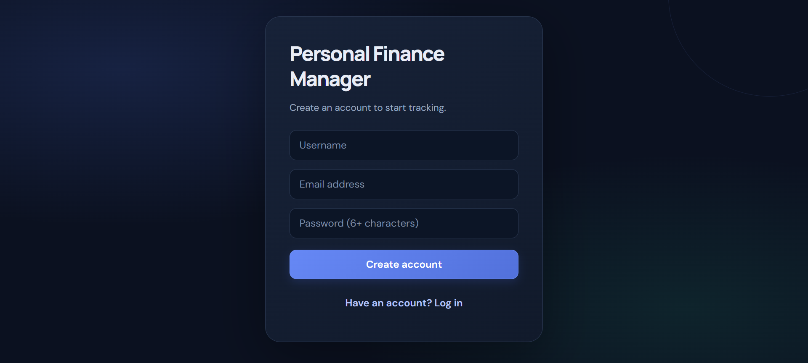

**2. User Login**

Securely access your personal finance dashboard.

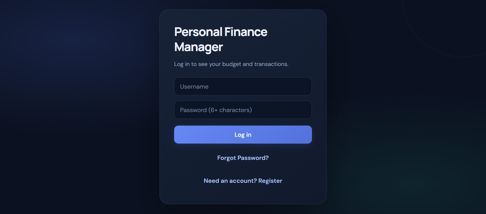

**3. Password Recovery**

Reset your account password through email verification.

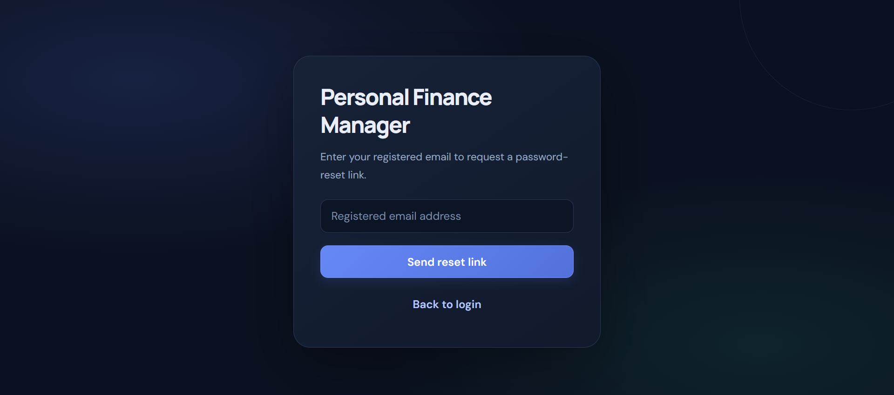

### 📊 Dashboard & Financial Overview

Get a complete overview of income, expenses, monthly budget, and available balance.

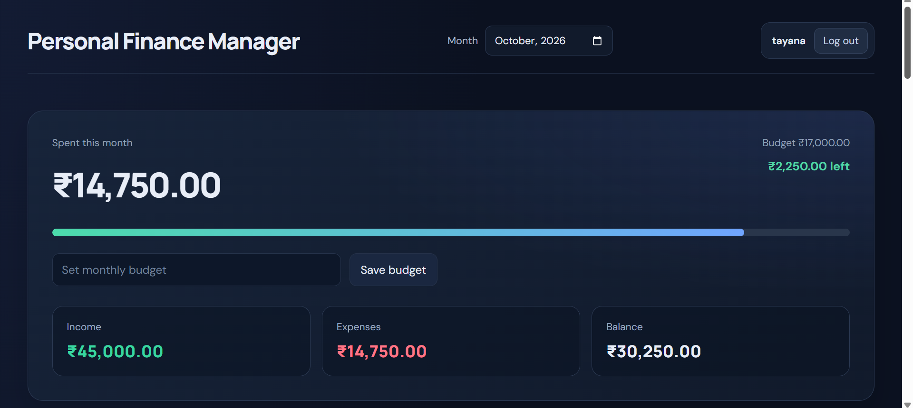

### 💳 Transaction Management

Track and manage your financial transactions in one place.

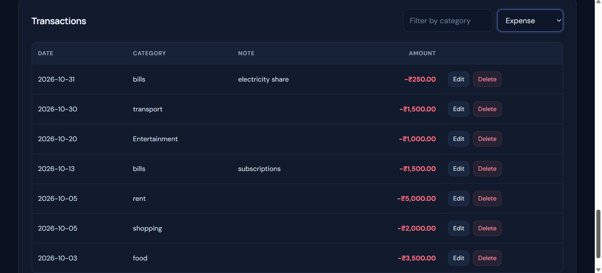

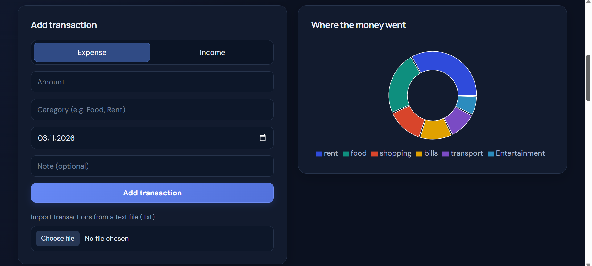

### 📈 Income & Expense Tracking

Monitor money coming in and money going out.

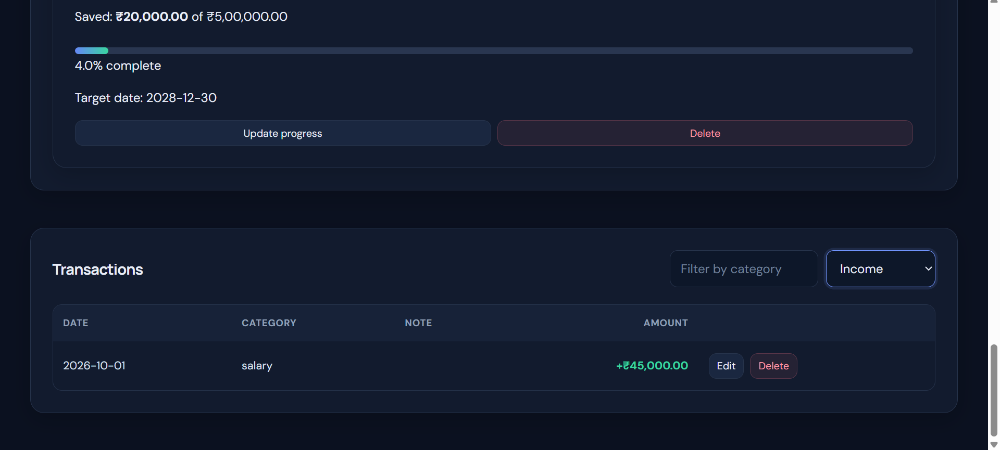

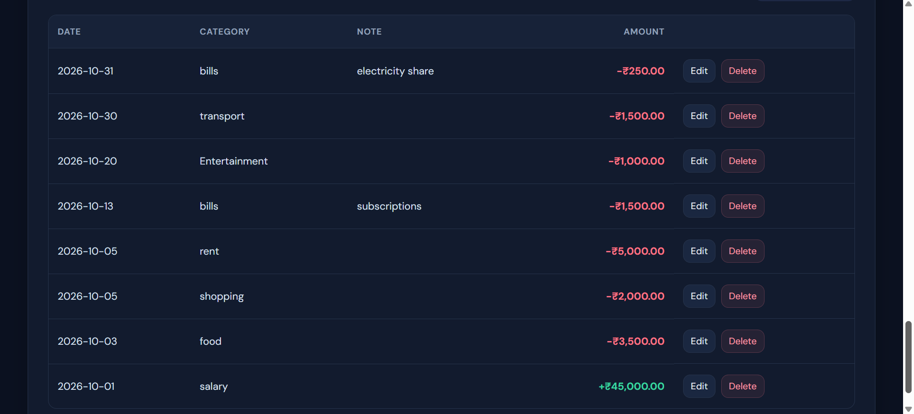

### 🎯 Savings Goals

Set financial targets, track savings progress, and stay motivated to achieve your goals.

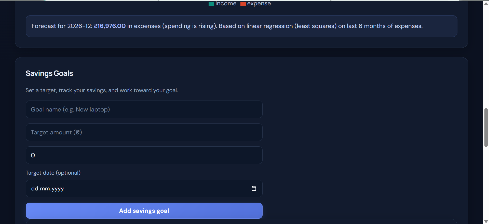

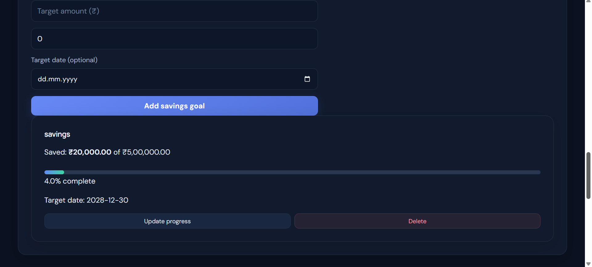

### 📉 Financial Analytics

Visualise financial activity and understand your spending patterns through monthly analytics.

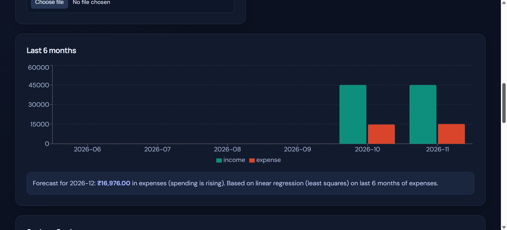


## 🛠️ Technology Stack

| Component | Technologies |
|---|---|
| Frontend | React, Vite, JavaScript, CSS |
| Data visualization | Recharts |
| HTTP communication | Axios, REST APIs |
| Backend | Java, Spring Boot |
| Security | Spring Security, JWT, BCrypt |
| Database | MySQL |
| Persistence | Spring Data JPA, Hibernate |
| Testing | JUnit, Mockito, Spring Boot Test |
| Build tools | Maven, npm |
| Deployment | Vercel, Render |
| Database Hosting | Aiven MySQL |
| Email Service | Brevo SMTP |

## 🏗️ Architecture

```text
             React Frontend
            (Vite + Recharts)
                    |
                 Axios
                    |
                REST API
                    |
             Spring Boot
                    |
        +-----------+-----------+
        |           |           |
   Controllers   Services   Security
        |           |
        +----- Repositories
                    |
                  MySQL
```

The backend follows a layered architecture:

- **Controller:** Handles HTTP requests and responses.
- **Service:** Implements business logic.
- **Repository:** Performs database operations.
- **Model:** Represents application entities.
- **DTO:** Defines request data and validation rules.
- **Security:** Handles authentication and authorization.
- **Email Service:** Handles password-reset emails through Brevo SMTP.

## 🔌 REST API

Authentication endpoints are used to register and log in. Protected endpoints require a valid JWT in the request's `Authorization` header.

| Method | Endpoint | Purpose |
|---|---|---|
| POST | `/api/auth/register` | Register a user |
| POST | `/api/auth/login` | Authenticate a user |
| GET | `/api/transactions` | Retrieve and filter transactions |
| GET | `/api/transactions/{id}` | Retrieve a transaction |
| POST | `/api/transactions` | Create a transaction |
| PUT | `/api/transactions/{id}` | Update a transaction |
| DELETE | `/api/transactions/{id}` | Delete a transaction |
| POST | `/api/transactions/import` | Import legacy transaction data |
| GET | `/api/summary?month=2026-10` | Retrieve monthly financial summary |
| PUT | `/api/budget` | Create or update a monthly budget |
| GET | `/api/analytics/categories?month=2026-10&type=EXPENSE` | Retrieve category totals |
| GET | `/api/analytics/monthly?months=6` | Retrieve monthly trends |
| GET | `/api/analytics/forecast` | Retrieve the expense forecast |

### Example API Request

Create an expense using a valid JWT:

```bash
curl -X POST http://localhost:8080/api/transactions \
  -H "Content-Type: application/json" \
  -H "Authorization: Bearer YOUR_JWT_TOKEN" \
  -d '{
    "amount": 450.50,
    "category": "Food",
    "type": "EXPENSE",
    "date": "2026-10-15",
    "description": "Lunch"
  }'
```

Replace `YOUR_JWT_TOKEN` with a token obtained through the login endpoint. Never commit real tokens to GitHub.

## 💻 Run Locally

### Prerequisites

Install the following tools:

- Java 17 or later, compatible with the project's Maven configuration.
- Maven.
- Node.js 18 or later and npm.
- MySQL Server 8 or a compatible version.

### 1. Clone the Repository

```bash
git clone https://github.com/tanayapatil26/Personal-finance-manager.git
cd Personal-finance-manager
```

### 2. Configure MySQL

Create the database:

```sql
CREATE DATABASE finance_db;
```

Ensure your local MySQL server is running.

### 3. Configure the Backend

Open a terminal in the `backend` directory.

Configure the environment variables required by the application:

- `DB_USER`: MySQL username.
- `DB_PASSWORD`: MySQL password.
- `JWT_SECRET`: A strong, private secret used to sign JWTs.
- `MAIL_PASSWORD`: Brevo SMTP key used to send password-reset emails.

For Windows PowerShell, for example:

```powershell
$env:DB_USER = "root"
$env:DB_PASSWORD = Read-Host "Enter your local MySQL password"
$env:JWT_SECRET = Read-Host "Enter your local development JWT secret"
$env:MAIL_PASSWORD = Read-Host "Enter your Brevo SMTP key"
```

Use your own local credentials and a suitable development secret. Do not commit secrets to the repository.

Start the backend:

```powershell
mvn spring-boot:run
```

The backend normally runs at:

`http://localhost:8080`

Keep this terminal open while using the application.

### 4. Configure and Start the Frontend

Open a second terminal:

```bash
cd frontend
npm install
npm run dev
```

Vite normally serves the frontend at:

`http://localhost:5173`

Keep the backend and frontend running in their respective terminals.

> The frontend's API URL must be configured for your local backend. Check the project's frontend configuration if requests are sent to the deployed API instead.

## 🐳 Run with Docker

Docker Compose can start the frontend, backend, and MySQL database together.

From the project root, create a local `.env` file based on `.env.example`:

```bash
cp .env.example .env
```

Edit `.env` and configure `DB_USER`, `DB_PASSWORD`, `JWT_SECRET`, and `MAIL_PASSWORD` with suitable private values.

Then run:

```bash
docker compose up --build
```

When all services are ready, open:

`http://localhost:3000`

The backend is exposed on port `8080`. MySQL data is stored in a Docker volume.

**Security note:** The Docker Compose configuration is intended for local development. Review the CORS configuration, secret management, and network exposure before adapting it for production.

## 🧪 Testing and Verification

The following checks have been performed during development:

- Backend Maven test suite completed successfully, with 7 tests passing and no failures in the recorded run.
- Frontend production build completed successfully using Vite.
- Authentication and protected endpoint behavior were tested locally.
- Transaction input validation was checked.
- Transaction creation, retrieval, updating, and deletion were exercised.
- User-scoped transaction access was tested for selected scenarios.
- The deployed application was checked for login, dashboard operation, and transaction persistence after refreshing the page.
- Forgot-password and password-reset email workflows were verified.
- Budget management and savings-goal functionality were tested.
- Transaction import functionality was verified.
- Deployed frontend and backend integration was tested successfully.

The frontend build reports a large JavaScript bundle warning. Reducing bundle size through code splitting is a potential future optimization.

These results describe the scenarios tested; they do not guarantee that every possible bug or security issue has been eliminated.

## 🔐 Security Practices

- Passwords are hashed rather than stored as plain text.
- Protected API endpoints require authentication.
- Transaction operations use the authenticated user's identity.
- Request validation helps reject invalid transaction data.
- Database credentials and JWT secrets should be supplied through environment variables.
- Test accounts should use fictional financial data.

Never publish passwords, production secrets, database connection credentials, or JWT tokens in source code or documentation.

## 🚀 Future Improvements

Potential enhancements include:

- CSV export for transactions.
- Improved pagination and sorting for large transaction histories.
- Frontend code splitting and bundle-size optimization.
- Broader automated tests for controllers, authentication, authorization, and analytics.
- Improved forecasting evaluation using historical data.
- Better demo data and screenshots for new users.

<a id="about-the-project"></a>
## 👩‍💻 About the Project

This project demonstrates practical application of Java programming, REST API development, database persistence, authentication, frontend integration, financial calculations, testing, and deployment.

It also demonstrates the evolution of a console-based Java application into a full-stack web application.
